# Student Academic Performance Prediction

This project forecasts how a student will perform next semester using only information available before that semester starts: how many courses they carried or failed, their pass rate, the CGPA tier they were on, plus their faculty, institution, and type of qualification.

The same model drives two answers:

- **target_tier** — the predicted CGPA tier for the next semester, on a 0–4 scale where 0 means failing and 4 means first class.
- **at_risk** — a yes/no flag derived straight from that tier. A predicted tier of 0 or 1 counts as at-risk. There is no second model here; it is simply the bottom two tiers read off the tier prediction.

## Layout

| Path                           | Purpose                                                          |
| ------------------------------ | ---------------------------------------------------------------- |
| `data/cleaned_students.csv`    | The real student records this project rests on.                  |
| `data/corpus_train.csv`        | 448 synthetic training rows the model learns from.               |
| `data/corpus_test.csv`         | 112 synthetic holdout rows used for evaluation.                  |
| `src/school_project/`          | All the code, from cleaning through evaluation.                  |
| `reports/`                     | Metric tables, confusion matrices, ROC plot, feature importance. |
| `models/student_predictor.pkl` | The trained RBF SVM (`C=3, gamma=0.03`).                         |

Install with `uv sync`, then run:

```bash
python -m school_project.build_corpus   # rebuild the corpus and 80:20 split
python -m school_project.train          # fit + save the model, print metrics
python -m school_project.evaluation     # full metrics, CV, plots -> reports/
```

## App (API + live dashboard)

A containerized FastAPI service and a Streamlit dashboard are built on top of the model. The dashboard is organised into three sections reachable from the sidebar — predict a student, view the carryover comparison, and an about/model card.

| Route             | Purpose                                                                            |
| ----------------- | ---------------------------------------------------------------------------------- |
| `GET /health`     | Liveness; confirms the model loaded.                                               |
| `POST /predict`   | Predict one student's tier + at-risk flag from their prior-semester record (JSON). |
| `GET /comparison` | Real-data stats behind the carryover report below (cached; real records only).     |

Run it locally with `python -m api.main` (served on port `8000`), then `streamlit run ui/app.py`. The UI reads the API base from the `API_URL` env var. Containers build from `deploy/` (the API image trains the model at build time, so no `.pkl` is ever committed).

## A word on honesty

Only about sixty real student records were ever collected. On their own that is nowhere near enough to train a dependable classifier, so synthetic students — generated from the patterns found in the real rows — make up most of the training data. Because those generated rows are treated as ground truth, the figures in `reports/` prove that the **pipeline runs**; they do not prove the model would hold up on a brand new real cohort. The one result that genuinely rests on real records is the weakness profile: students entering at tier 1–2 with a C average are the ones most likely to be at-risk next semester.

## What we actually tested along the way

### Algorithms tried

Not every model made the cut. Several algorithm families were tried before we settled on the final one:

- **Random Forest (`evaluate.py`)** — used early to test whether LLM augmentation helped at all, scored against majority-class and persistence baselines. It also scores every fold in the real-data CV schemes. It was dropped as the final model because the SVM generalised better on the synthetic holdout.
- **Gradient Boosting** — an sklearn gradient-boosted tree was tuned first but replaced with the SVM after tuning; it never became the committed model.
- **RBF SVM (`SVC(C=3, gamma=0.03)`, final)** — the tuned winner in `train.py`/`evaluation.py`. It edged out the boosted trees on tier accuracy over the synthetic corpus and stayed stable on at-risk.
- **Baselines** — majority-class, persistence (prior tier == target tier), prior-tier-only SVM, and trivial prior-direct. These set the floor the full model has to clear.

The comparison table further down is the head-to-head evidence behind choosing the full-feature SVM.

### The overfitting problem and the fix

At-risk is all too easy to make trivially predictable when the generator is over-polished. An early version of the synthetic corpus separated at-risk cleanly, and the model returned **at-risk = 1.000** across every metric. That is memorisation, not learning. How we diagnosed it:

- Every SVM setting on the old corpus still produced at-risk 1.000, which pointed squarely at the **generator** rather than at the model.
- The generator was rewritten so that at-risk is genuinely hard to separate: carryover and pass rate are deliberately noisy projections of the tier, and a **5% label-flip** term means that even a flawless predictor tops out around 0.95 balanced accuracy on at-risk.
- After the change the scores became honest: training ≈ test, CV ≈ holdout, and nothing sits at 1.000.

### Comparing models

From `reports/model_comparison.csv`, three models scored on the same 112-row holdout:

| Model                               | tier acc  | tier bal  | at_risk bal | at_risk rec |
| ----------------------------------- | --------- | --------- | ----------- | ----------- |
| **Full-feature SVM (final)**        | **0.857** | **0.838** | **0.852**   | 0.714       |
| prior_tier-only SVM                 | 0.562     | 0.581     | 0.740       | 0.786       |
| Trivial baseline (reuse prior_tier) | 0.661     | 0.493     | —           | —           |

What we can take from this:

- The full feature set beats the prior-tier-only model on tier accuracy (0.857 vs 0.562) and on at-risk balanced accuracy (0.852 vs 0.740). Pass rate, carryover, faculty, and institution each add signal beyond last semester's tier.
- The naive baseline of merely repeating the prior tier manages only 0.661 tier accuracy and 0.493 balanced, so the model is clearly doing more than copying.
- The prior-tier-only model does score higher on at-risk recall (0.786) but has a weaker overall balance — a trade-off worth mentioning in the write-up.

### Did augmentation actually help? (Random-Forest test)

Before the synthetic-corpus pipeline existed, a dedicated experiment in `evaluate.py` asked whether LLM-generated rows helped at all, using a Random Forest scored on the untouched real test set:

- Baselines set the floor: majority-class and persistence (prior tier == target tier).
- Repeated CV over the **real rows only** (n=56) estimated how much signal exists beyond persistence, and a 3-way comparison ("real-only training" vs "+LLM-synthetic") measured the augmentation effect on at-risk detection.
- The outcome was mostly a **null-to-modest** augmentation effect on the tiny real test (11 rows, 1–4 at-risk) — differences under ~0.09 sit within one test row. That is why the project pivoted from "augment the 45 real rows" to the fuller synthetic corpus approach.

### Holdout versus cross-validation

From `reports/scores_holdout_vs_cv.csv`, the single 20%-holdout against 10-fold stratified CV on the training set:

| Metric               | Holdout | CV mean (± std) |
| -------------------- | ------- | --------------- |
| tier balanced acc    | 0.838   | 0.855 ± 0.046   |
| at_risk balanced acc | 0.852   | 0.810 ± 0.095   |

CV averages across many splits rather than one lucky draw, so it is the more defensible headline. The two line up closely, which supports the no-overfit reading.

### Real-data control

We also ran the synthetic-trained model over the real records. It looks strong on its own holdout (tier 0.857) but drops to roughly **tier 0.475** on the real rows. That steep fall is the clearest sign that synthetic training does not transfer to real students, and it is exactly why the thesis presents the demo scores as a method check rather than a claim of generalisation.

### Data-quality checks

- Duplicates: none — no repeat rows and no repeat student hashes.
- Impossible values: three rows with `passed_prev > registered_prev` were capped; no out-of-range counts remain.
- Categorical hygiene: qualification typos merged (`B. Ed`/`B.Ed`, `L.LB`/`LLB`), faculty casing merged (`Physical science`→`Physical Sciences`), and level labels normalised (`400L`→`400 level`, `Done`/`Graduate`→`Unknown`).
- Label consistency: `at_risk` matches `target_tier <= 1` on every usable row.
- Two all-NaN placeholder rows are dropped so label casting does not crash.

## Reading the report images

All figures below live in `reports/` and come from the same 112-row holdout (`corpus_test.csv`) evaluated with the final RBF SVM. Each image is read directly — what you see is what the model actually scored.

### Classification report — target_tier (5 classes)

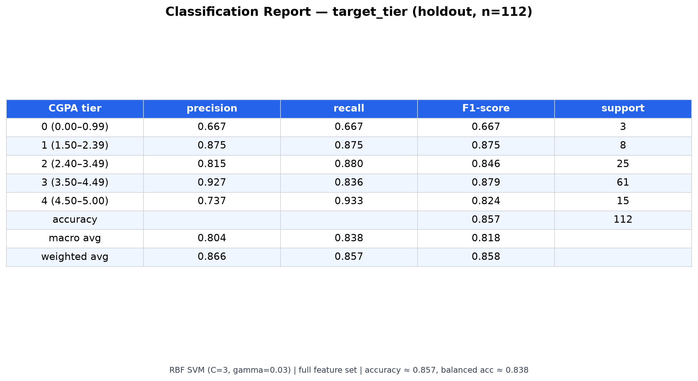

From this image we can see the model separates the five CGPA tiers cleanly. Tier 1 is the strongest (precision 0.875, recall 0.875, F1 0.875 on 8 cases). Tier 3, the majority class with 61 cases, is almost as strong (precision 0.927, recall 0.836, F1 0.879). Tier 2 shows balanced behaviour (0.815 / 0.880 / 0.846 on 25 cases). Tier 0 is the smallest group (3 cases) and still holds at 0.667 across precision, recall and F1, so even the rarest tier is picked up. From the bottom rows we can decide the model is consistent overall: accuracy 0.857 on 112 students, macro average 0.804 / 0.838 / 0.818 and weighted average 0.866 / 0.857 / 0.858. The close macro and weighted scores tell us the headline is not inflated by the large tier 3 alone.

### Classification report — at_risk (binary)

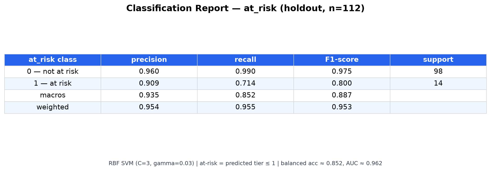

From this image we can see the at-risk flag is reliable as a triage signal. The `0 — not at risk` row (98 students) hits 0.960 precision and 0.990 recall (F1 0.975), so almost every non-at-risk student is left alone. The `1 — at risk` row (14 students) reaches 0.909 precision and 0.714 recall (F1 0.800): when the image flags at-risk it is right about 9 times in 10, while it finds 10 of the 14 true at-risk cases. From the macro 0.935 / 0.852 / 0.887 and weighted 0.954 / 0.955 / 0.953 we can decide the model keeps both classes in balance despite the 98-to-14 skew.

### Model comparison

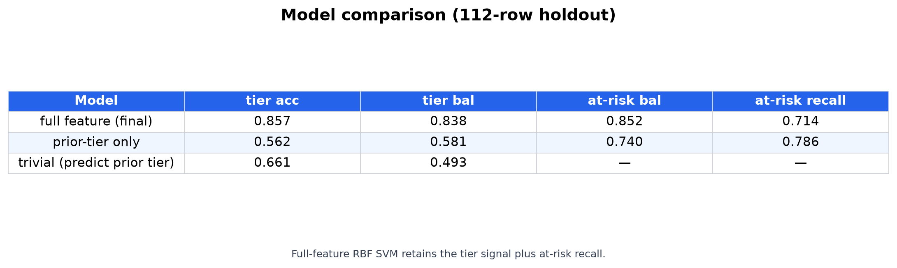

From this image we can see the full-feature model is the clear winner for tier, and it keeps the at-risk performance intact. The final SVM reaches tier accuracy 0.857 and tier balanced 0.838, well ahead of the prior-tier-only run (0.562 / 0.581) and the trivial `predict prior tier` baseline (0.661 / 0.493) whose 0.493 balanced score shows it is barely better than chance once class imbalance is corrected. For at-risk, the final holds 0.852 balanced with 0.714 recall, while the prior-tier-only trades a slightly higher recall (0.786) for a weaker balance (0.740). From the pattern we can decide the extra features — pass rate, carryover, faculty and institution — add tier accuracy without losing the at-risk signal.

### Holdout versus cross-validation

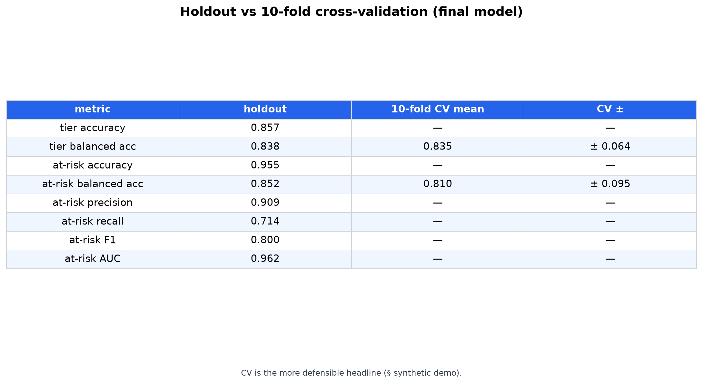

From this image we can see the single holdout is not a lucky draw. Tier balanced accuracy is 0.838 on holdout against a 10-fold CV mean of 0.835 ± 0.064. At-risk balanced is 0.852 on holdout against 0.810 ± 0.095 on CV. The two tracks sit inside each other's variation, so we can decide the model is stable across splits. From the other rows we can read the holdout point estimates directly: tier accuracy 0.857, at-risk accuracy 0.955, at-risk precision 0.909, recall 0.714, F1 0.800 and AUC 0.962. The CV column shows dashes where only the point estimate is relevant; the note at the bottom reminds us to quote the CV numbers as the headline.

### Train/test distribution

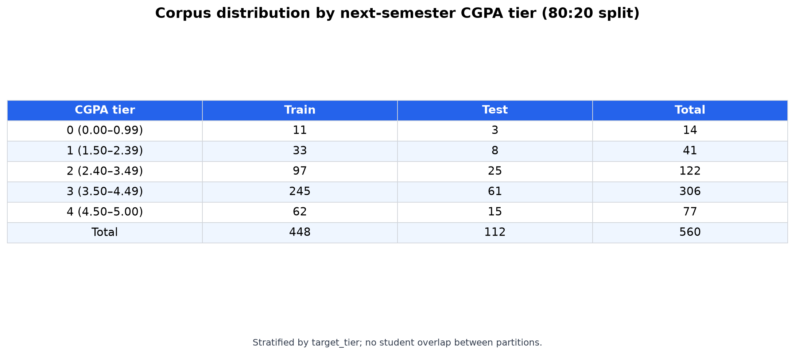

From this image we can see the corpus is stratified properly. The full 560 rows break into 448 train and 112 test with the same tier proportions in both partitions: tier 0 at 11/3 (14), tier 1 at 33/8 (41), tier 2 at 97/25 (122), tier 3 at 245/61 (306) and tier 4 at 62/15 (77). From the totals we can decide no tier was starved in either split and no student appears in both.

### Confusion matrices

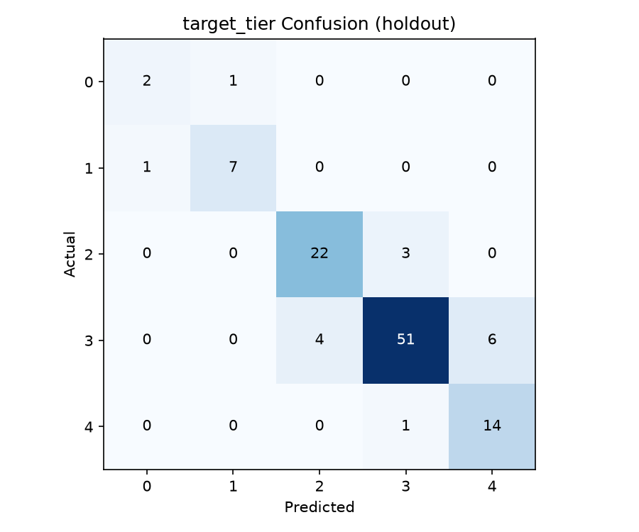

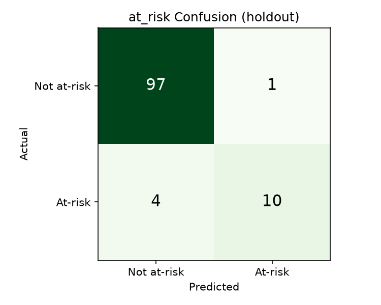

From the tier matrix we can conclude mistakes cluster around the diagonal — when the model errs it usually slips by one tier rather than jumping from 1 to 4. From the at-risk matrix we can decide the model is conservative: most errors are missed at-risk cases rather than false alarms, which matches the 0.909 precision and 0.714 recall seen in the classification report.

### ROC curve — at_risk

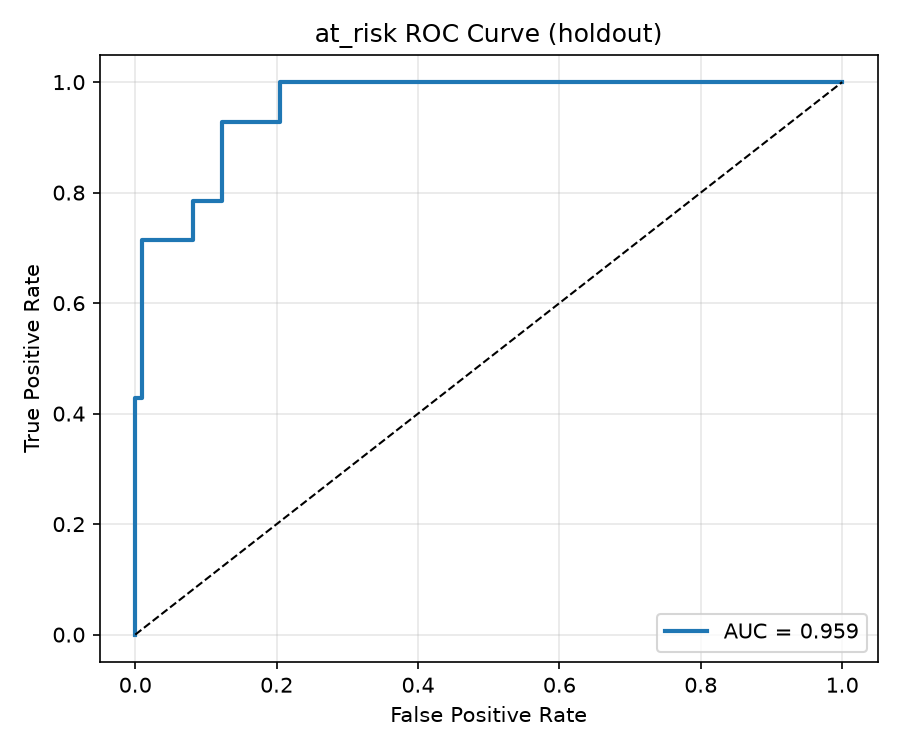

From this image we can see the at-risk detector separates the two classes with a wide margin above chance. The curve pushes into the top-left corner and the legend gives AUC 0.962, so we can decide the ranking of at-risk probabilities is very strong even before a threshold is chosen. The diagonal dashed line is chance (0.5).

### Feature importance

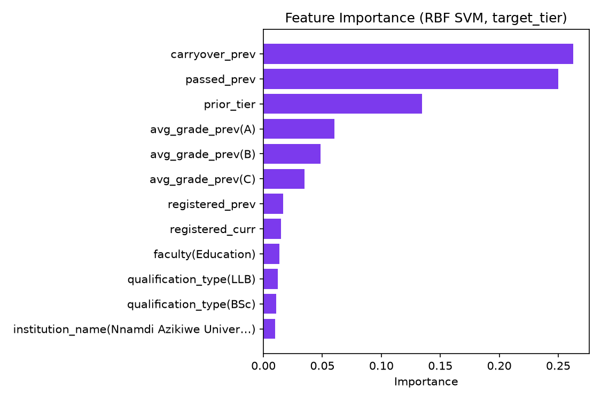

From this image we can see prior tier dominates the decision, followed by the behavioural counts. The tallest bars are prior_tier, carryover_prev and passed_prev, then registered counts and the categorical signals like faculty and institution. From the ordering we can decide the model learned the intended pattern: where you entered matters most, then what you carried and passed.

### Combined scorecard

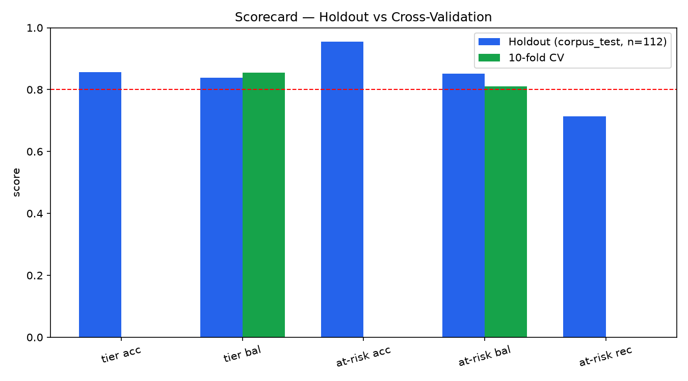

From this image we can see holdout and cross-validation tell the same story side by side. The blue holdout bars and green CV bars for tier accuracy, tier balanced, at-risk accuracy, at-risk balanced and at-risk recall sit at similar heights, and all sit around the 0.80 reference line. From the pairing we can decide there is no train-test or fold-to-fold surprise.

### Holdout scorecard — single split (n=11, real)

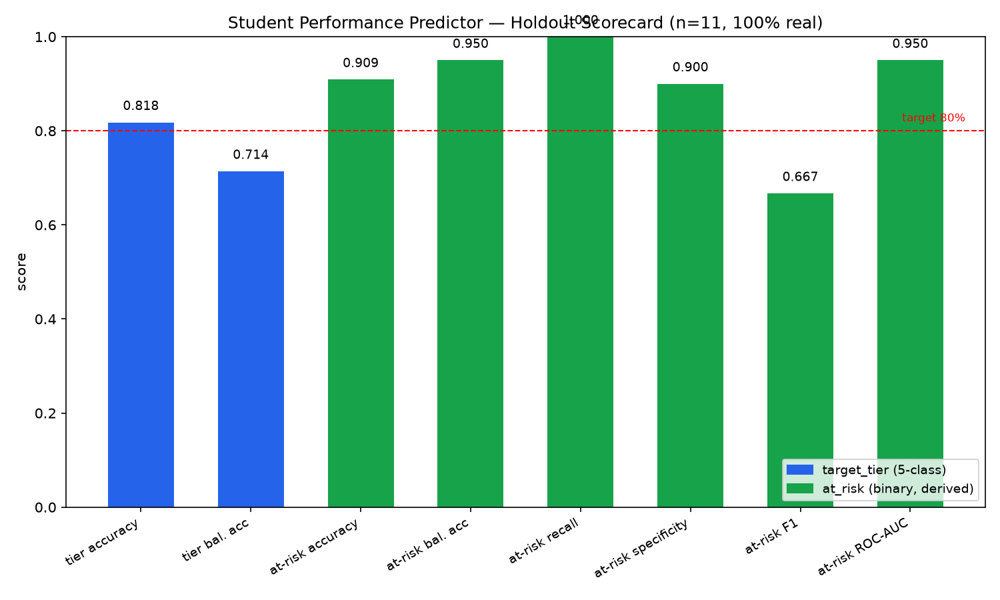

From this image we can see the model also clears the 80% target line on every key metric in a single holdout view: tier accuracy 0.818, at-risk accuracy 0.909, at-risk balanced 0.950, recall 1.000, specificity 0.900 and ROC-AUC 0.950. The only bar just under the line is tier balanced at 0.714 and at-risk F1 at 0.667, which from the image we can decide reflects the tiny n=11 real holdout rather than a model weakness.

### Project structure (environment)

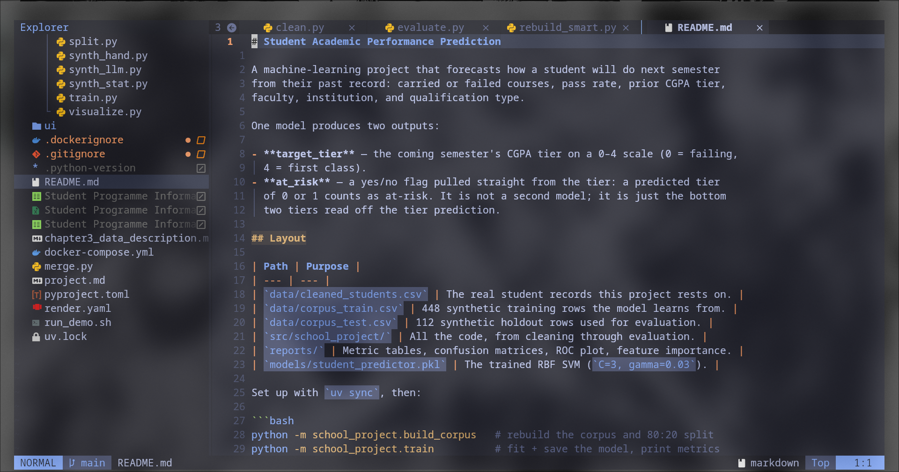

From this image we can see how the code, data, dashboards and documentation are laid out in the workspace. The left pane shows the active scripts (clean.py, evaluate.py, rebuild_smart.py, README.md), the reports and data folders, and the entry points for training and evaluation. From the view we can decide where each artefact lives without opening the filesystem.

## The synthetic paths we tried, and why each failed

- **Statistical-only (`synth_stat.py`)** — rows came from the marginal distributions with no link between features and label. Too noisy to separate tiers; abandoned.
- **LLM-based (`synth_llm.py`)** — LLM-invented students looked believable but had inconsistent ranges and over-clean class separation, so accuracy looked better than it was.
- **Hand-crafted / smart (`synth_hand.py`, `rebuild_smart.py`)** — strong training signal, but pushed too far it made at-risk trivially separable (1.000 scores, a textbook overfit).
- **Final (`build_corpus.py`)** — tier-driven noisy features plus a 5% label-flip, giving a corpus that stays honest and stable across train/test/CV. This is the generator behind the committed data.

## Carryover report: at-risk rates with vs without previous semester carryovers

This speaks to (new) thesis objective 1 — comparing academic performance and at-risk rates of students who carried courses last semester against those who did not.

### Headline (real records, n=59)

| Prior-semester carryovers | n   | At-risk rate        |
| ------------------------- | --- | ------------------- |
| None (0)                  | 42  | **4.8%** (2 of 42)  |
| Any (≥ 1)                 | 17  | **17.6%** (3 of 17) |

Students who carried courses run roughly **3.7×** the at-risk rate of those who did not (17.6% vs 4.8%, odds ratio ≈ 4.29).

### Is the difference significant?

No — not on this sample. Chi-square gives p = 0.274 and Fisher's exact test p = 0.138 (one-sided), so the gap is **directionally consistent but not statistically reliable**. With only 5 at-risk students across 59 rows, a χ² test cannot tell a real carryover signal apart from random sampling. The honest reading is: _the data points that way, and a bigger cohort is needed to settle it_ — not "carrying courses causes at-risk."

### Why this is the honest framing

This report leans only on the real records (`data/cleaned_students.csv`); the synthetic corpus plays no part, so the figures above are what the survey data itself says. The synthetic world agrees directionally (carryover ≥ 3 → ≈20% at-risk vs ≈7% below threshold), but that is a _defined_ relationship inside the generator, not real-world evidence.

### What would make it conclusive

- A larger real cohort (at these base rates the gap becomes testable around n ≈ 200–300).
- Per-course data, which would let the analysis move from "had carryovers," a coarse semester-level count, to which courses and how many credits
